<!-- Tarjeta Principal / Banner Hero Terminal -->

 

<!-- Línea Divisoria Neón Esmeralda -->

  

 

<!-- Conecta Conmigo & Badges de Redes -->

 

<!-- Tarjeta Sobre Mí / Developer Spec -->

  

 

  

 

<!-- Sección de Tecnologías y Herramientas -->
<h3 align="center"><code>[ // STACK_TECNOLOGICO_Y_HERRAMIENTAS ]</code></h3>

 

<!-- Backend -->

<strong>⚡ Backend &amp; Arquitectura</strong>

  

<!-- Frontend -->

<strong>🎨 Frontend &amp; UI</strong>

  

<!-- Bases de Datos -->

<strong>🗄️ Bases de Datos</strong>

  

<!-- Entorno y DevOps -->

<strong>🛠️ Entorno de Desarrollo &amp; Control de Versiones</strong>

 

  

 

<!-- Sección de Proyectos Destacados -->
<h3 align="center"><code>[ // PROYECTOS_DESTACADOS ]</code></h3>

<table align="center" width="100%">
  <tr>
    <td width="50%" valign="top">
      <h4 align="center">☕ <a href="https://github.com/emanuelca109/laravel_coffee">Coffee.Dat</a></h4>
      

        
        
        
        
      

      

        Plataforma de comercio electrónico y catálogo digital enfocada en la comercialización de insumos, maquinaria y productos para el gremio de la caficultura. Arquitectura MVC robusta con autenticación, carrito y panel de administración.
      

    </td>
    <td width="50%" valign="top">
      <h4 align="center">📦 <a href="https://github.com/emanuelca109/sistema_inventario">Sistema de Inventario</a></h4>
      

        
        
        
        
      

      

        Software empresarial para el control y administración de almacén: entradas, salidas, cálculo de stock mínimo, gestión de proveedores, reportes y trazabilidad de productos en tiempo real.
      

    </td>
  </tr>
  <tr>
    <td width="50%" valign="top">
      <h4 align="center">🎓 <a href="https://github.com/emanuelca109/sistema-calificaciones">Sistema de Calificaciones</a></h4>
      

        
        
        
        
      

      

        Plataforma de gestión académica orientada a instituciones educativas. Permite el control de docentes, alumnos, asignaturas, ponderación de evaluaciones y emisión de boletines de notas.
      

    </td>
    <td width="50%" valign="top">
      <h4 align="center">🌿 <a href="https://github.com/emanuelca109/eco-bingo">Eco-Bingo</a></h4>
      

        
        
        
      

      

        Proyecto interactivo y dinámico diseñado con fines pedagógicos y de sensibilización ambiental, utilizando mecánicas de gamificación para fomentar la conciencia ecológica.
      

    </td>
  </tr>
</table>

 

  

 

<!-- Sección de Telemetría y Métricas GitHub -->
<h3 align="center"><code>[ // TELEMETRIA_Y_METRICAS_GITHUB ]</code></h3>

<!-- Tarjetas de Estadísticas y Lenguajes (Tema Oscuro con Acentos Neón Esmeralda) -->

  

<!-- Racha de Contribuciones -->

 

<!-- Footer con Ola Neón Esmeralda -->

